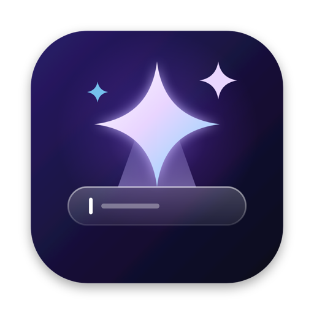
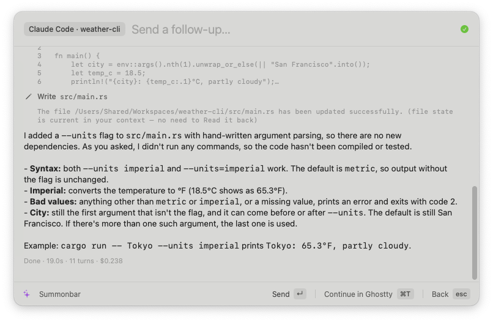
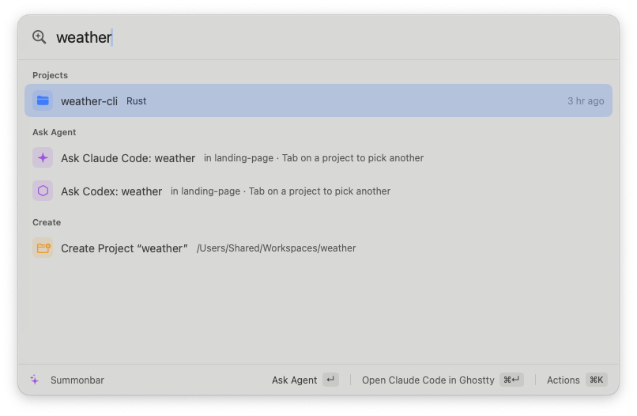

<p align="center">
  
</p>

<h1 align="center">Summonbar</h1>

<p align="center">
  <b>A Raycast-style launcher for macOS with coding agents built in.</b><br>
  Press a hotkey, pick a project, type a task. Claude Code, Codex and others answer right inside the bar.
</p>

<p align="center">
  
  
  
  <a href="LICENSE"></a>
  <a href="CONTRIBUTING.md"></a>
</p>

<p align="center">
  
</p>

## Why

Coding agents live in terminals. That's great for long sessions, but most tasks are short: "add a flag", "why is this test failing", "scaffold a new app". Summonbar gets you from that thought to a running agent in the right folder in about two keystrokes, and lets you leave it running in the background.

- **Every project, one keystroke away.** Summonbar scans `~/Workspaces` (including group folders like `~/Workspaces/acme/*`) and ranks projects by what you used last.
- **Inline agent runs.** The answer streams into the launcher, with tool calls, file edits, command output and cost. Press ↵ to send a follow-up in the same session.
- **Hand off to the terminal.** ⌘T moves an inline conversation into your terminal (`claude --resume`, `codex resume`). ⌘↵ on a project opens the agent there right away.
- **New projects in one line.** `new my-app: build a todo app` creates `~/Workspaces/my-app`, runs `git init`, and pre-fills the prompt.
- **Background runs.** Hide the launcher and keep working. The menu bar shows how many agents are running.
- **Your Claude Code commands and skills.** Anything in a project's `.claude/commands` and `.claude/skills` shows up in the launcher and runs inline; your personal ones in `~/.claude` are a `/` away.
- **Prompt extensions.** Small scripts that gather context (a diff, failing test output, logs) and hand it to an agent as the task.
- **An app launcher too.** Installed apps show up in search with aliases, per-app global hotkeys, and quit / restart / hide / force quit / trash from ⌘K, like Raycast.
- **Translate as you type.** `tr bonjour` shows the translation right in the list; ↵ copies it.
- **Native and small.** Swift + AppKit/SwiftUI, no Electron and no dependencies. It doesn't need Accessibility permission.

<p align="center">
  
</p>

## Supported agents

Summonbar uses whichever of these are on your `PATH`, with the same login-shell environment your terminal has (nvm, `~/.local/bin`, …):

| Agent | Inline runs | Open in terminal | Resume |
|---|---|---|---|
| [Claude Code](https://docs.claude.com/en/docs/claude-code) | ✅ streamed | ✅ | ✅ |
| [Codex CLI](https://github.com/openai/codex) | ✅ streamed | ✅ | ✅ |
| Gemini CLI, Cursor Agent, opencode, Aider | plain output | ✅ | — |

## Install

Requires macOS 14+.

### Download

1. Grab `Summonbar-<version>.zip` from the [latest release](https://github.com/toilahuongg/summonbar/releases/latest). It's a universal build for Apple Silicon and Intel.
2. Unzip it and move `Summonbar.app` to `/Applications` (or `~/Applications`).
3. The app is ad-hoc signed but not notarized, so macOS blocks it the first time you open it. Right-click the app and choose **Open**, then **Open** again in the dialog. On macOS 15, if there's no Open button, go to **System Settings → Privacy & Security** and click **Open Anyway**. Or clear the quarantine flag from a terminal:

   ```bash
   xattr -dr com.apple.quarantine /Applications/Summonbar.app
   ```

### Build from source

You need a Swift toolchain. The Xcode Command Line Tools are enough; you don't need full Xcode.

```bash
git clone https://github.com/toilahuongg/summonbar.git
cd summonbar
./scripts/build-app.sh --install   # builds Summonbar.app, copies it to ~/Applications and launches it
```

## Use

Default hotkey: **⇧⌘Space** (change it in Settings).

| Where | Key | Action |
|---|---|---|
| Anywhere | ↑ ↓ | Move selection |
| | ↵ / ⌘↵ | Primary / secondary action (shown in the footer) |
| | ⌘K | More actions for the selected item |
| | esc, or ⌫ on an empty field | Back / hide |
| | ⌘R · ⌘, | Reload projects & config · Settings |
| Project | ↵ or Tab | Ask an agent in this project |
| | ⌘↵ | Open the default agent in the terminal |
| Root search | type anything | "Ask Claude Code: …" runs it in the project you used last |
| | `new my-app` | Create `~/Workspaces/my-app` (with `git init`) |
| | `new my-app: build a todo app` | Create it and pre-fill the prompt |
| | `new acme/foo` | Create it inside a group folder |
| | `tr <text>` or `translate <text>` | Translate it inline; ↵ copies the translation |
| Agent run | ↵ | Send a follow-up (resumes the same agent session) |
| | ⌘T | Continue this conversation in the terminal (`claude --resume` / `codex resume`) |
| | ⌘. | Stop the run |

Run history is saved in `~/Library/Application Support/Summonbar/runs.json`.

### Scripting

```bash
open -a Summonbar --args --ask claude ~/Workspaces/foo "fix the failing test"
open -a Summonbar --args --query "new my-app"
open -a Summonbar --args --settings
```

These only work when Summonbar isn't already running.

## Settings

Open **Settings** with ⌘, in the launcher or from the menu bar. It covers:
- the hotkey (click and press a new shortcut)
- launch at login
- the workspaces folder
- terminal and editor
- the default agent
- the translation languages
- per-agent arguments
- app aliases, hotkeys and which apps show in search

Changes save to the config file and apply right away.

The file itself, `~/.config/summonbar/config.json`, is created on first launch:

```json
{
  "workspacesRoot": "~/Workspaces",
  "hotkey": "cmd+shift+space",
  "terminal": "ghostty",
  "editor": "Visual Studio Code",
  "defaultAgent": "claude",
  "gitInitNewProjects": true,
  "agents": {
    "claude": { "args": [], "headlessArgs": ["--permission-mode", "acceptEdits"] },
    "codex":  { "args": [], "headlessArgs": ["--sandbox", "workspace-write"] }
  }
}
```

- `terminal`: `ghostty`, `terminal`, `iterm`, or any app name that can open `.command` files.
- `headlessArgs` apply to inline runs. By default Claude Code can edit files but asks before running anything else, and Codex is sandboxed to the workspace. Set `"disabled": true` on an agent to hide it.
- `translation` (optional): `{ "to": "en", "alternate": "vi" }`. Text goes into `to`, or into `alternate` when it's already in `to`. `to` defaults to English and `alternate` to your first other system language; set `alternate` to `""` to turn it off. Codes are Google Translate's (`zh-CN`, `ja`, `pt`, …).
- `extensionDirectories` (optional): extra folders to load extensions from, e.g. a team repo of shared prompts.
- `applications` (optional), keyed by bundle identifier so the settings survive an app moving:

  ```json
  "applications": {
    "aliases": { "com.microsoft.VSCode": "code" },
    "hotkeys": { "com.mitchellh.ghostty": "ctrl+opt+t" },
    "hidden": ["com.apple.Chess"],
    "directories": ["/opt/homebrew/Caskroom"],
    "enabled": true
  }
  ```

  `directories` are scanned in addition to the default app folders. `enabled: false` leaves apps out of search.
- After you edit the file by hand, use **Reload Config & Hotkey** in the menu bar.

Projects are found by scanning `workspacesRoot`. If a top-level folder holds projects instead of being one (for example `~/Workspaces/acme/*`), its subfolders are listed as projects.

## Extensions

An extension is a reusable prompt for a coding agent: a script in `~/.config/summonbar/extensions/` (any language, with a shebang) that runs inside a project and prints the task. Whatever it prints is sent to the agent as an inline run. A few examples are created on first launch: review uncommitted changes, write a commit message, fix failing tests.

```bash
#!/bin/bash
# @summonbar.title Review Uncommitted Changes
# @summonbar.icon checkmark.seal
# @summonbar.argument1 { "type": "text", "placeholder": "Focus (optional)", "optional": true }

echo "Review my uncommitted changes for bugs and risky edits. ${1:+Focus on: $1}"
echo '```diff'
git diff HEAD | head -c 60000
echo '```'
```

| Key | Values |
|---|---|
| `title` | Required. Name in the list |
| `agent` | Agent id such as `codex` (default: `defaultAgent`) |
| `argument1`…`argument3` | JSON: `type` (`text`, or `dropdown` with `data: [{"title","value"}]`), `placeholder`, `optional`. Asked for one at a time |
| `icon` | SF Symbol name, emoji, or an image path relative to the script |
| `description` | Subtitle |
| `needsConfirmation` | `true` asks before running |

Scripts written for other output modes (`@summonbar.mode` set to anything but `agent`) are skipped.

Extensions show up in a project's ⌘K actions and prompt screen, and in root search for the project you used last. Scripts run in the project folder and get these environment variables:
- `SUMMONBAR_PROJECT_DIR` and `SUMMONBAR_PROJECT_NAME`.
- `SUMMONBAR_WORKSPACES`.

Keys on an extension:
- ↵ runs the script and sends its output to the agent.
- ⌘↵ previews the prompt first. There, ↵ sends it, ⌘↵ copies it and ⌘. stops the script. A script that fails opens the same preview so you can see why.
- ⌘K also has Edit Script and Reveal in Finder. ⌘R picks up new or changed scripts.

## Applications

Apps in `/Applications`, `/System/Applications`, `~/Applications` and their subfolders are listed in the root search next to projects. Whichever matches better comes first, so `slack` opens Slack and `summonbar` the project. Names match fuzzily and by initials (`vsc` → Visual Studio Code), and apps you open from Summonbar rank higher.

| Where | Key | Action |
|---|---|---|
| App | ↵ | Open it, or switch to it if it's running |
| | ⌘↵ | Reveal in Finder |
| | ⌘K | Hide / Unhide, Quit, Restart, Force Quit, Copy Path, Copy Bundle Identifier, Set Alias or Hotkey…, Hide from Search, Move to Trash |
| Running Applications | ↵ / ⌘↵ | Quit / switch to |

Commands in the root list:
- **Applications** browses everything installed.
- **Running Applications** lists apps with a Dock icon.
- **Quit All Applications** asks the apps to quit, except Finder, so they can still prompt you to save.

Force Quit, Quit All and Move to Trash ask for confirmation first. Apps in `/System` can't be trashed, and a running app has to be quit before it can be.

**Settings › Applications** has, for each app:
- an alias (an exact alias match always wins)
- a global hotkey, which opens the app and hides it again if it's already frontmost
- whether it shows in search

There's also a switch to leave apps out of search entirely; hotkeys keep working without it.

## Translate

Type `tr ` (or `translate `) and the text in the root search. The translation shows up as the first result while you type, with the detected language in the subtitle.

| Where | Key | Action |
|---|---|---|
| `tr …` result | ↵ | Copy the translation and hide the launcher |
| | ⌘↵ | Open it in the translator |
| | ⌘K | Translate into another language |
| Translator | ↵ | Copy the translation (after an error: try again) |
| | ⌘↵ | Swap languages: translate the result back |
| | ⌘K | Pick the language, or go back to Automatic |

The translator also opens from the **Translate** command and shows long text in full. By default text is translated into English, and English text into your first other system language, so with English and Vietnamese set up you never need to pick a language. Change both in **Settings › General › Translate** or with the `translation` key above.

Translations come from Google Translate's keyless web endpoint, so the text you translate is sent to Google.

## Claude Code commands and skills

Summonbar reads each project's own Claude Code setup and lists it next to the extensions:
- custom commands: every `.md` file in `.claude/commands/` (subfolders too), named after the file;
- skills: `.claude/skills/<name>/SKILL.md`, skipped when the front matter says `user-invocable: false`.

They show up in a project's ⌘K actions and prompt screen, and in root search for the project you used last. `description` and `argument-hint` from the front matter become the subtitle and accessory.

- ↵ sends `/name` to Claude Code as an inline run. If the command has an `argument-hint`, Summonbar asks for the arguments first.
- ⌘↵ opens it in the terminal instead. ⌘K also has Run with Arguments, Edit and Reveal in Finder. Tab goes straight to the arguments.
- On the prompt screen, typing `/` lists the project's commands and skills; `/plan next sprint` runs `/plan` with `next sprint`.

Your personal commands and skills in `~/.claude/commands` and `~/.claude/skills` work the same way, but they only appear when you type `/` on the prompt screen or search from the root, so they don't crowd every project's list. They're labelled Personal Commands / Personal Skills. When a project and `~/.claude` both define the same name, the project's wins.

They always run with Claude Code, whatever `defaultAgent` is, and are hidden when `claude` isn't on your `PATH`. The files are read again each time the launcher opens.

## How it works

- **The panel** is a borderless, non-activating `NSPanel`. It takes keyboard focus without pulling your editor out of the foreground, the same way Spotlight does. Keys are routed in `sendEvent`, and input methods such as Vietnamese Telex can finish composing before ↵ or esc are handled.
- **The hotkey** uses Carbon's `RegisterEventHotKey`, so no Accessibility permission is needed.
- **Inline runs** start the agent headless and parse its event stream:
  - Claude Code: `claude -p --output-format stream-json`.
  - Codex: `codex exec --json`.
  - The session id is kept so follow-ups and ⌘T resume the same conversation.
- **Environment:** on launch Summonbar reads your login shell's environment once, so agents installed through nvm, Homebrew or `~/.local/bin` are found just as they are in your terminal.

## Development

```bash
swift build                       # debug build
./scripts/build-app.sh            # release .app in build/
./scripts/make-icon.sh            # re-render Resources/AppIcon.icns from assets/logo.svg (needs Google Chrome)
```

```
Sources/Summonbar/
  App.swift            app delegate, menu bar item, launch args
  Panel.swift          floating non-activating panel, key routing
  HotKey.swift         global hotkey (Carbon)
  LauncherModel.swift  screens, items, navigation, actions
  Views.swift          SwiftUI UI
  Settings.swift       Settings window (General, Agents, Applications)
  AgentRun.swift       headless agent process + stream-json / JSONL parsing
  Extensions.swift     prompt extensions: metadata parsing, catalog, runs
  Agents.swift         agent catalog and command lines
  Projects.swift       workspace scanner, fuzzy match
  SlashCommands.swift  a project's .claude commands and skills
  Apps.swift           installed-app scanner, open / quit / restart / trash
  Translate.swift      languages, Google Translate client, live translation state
  Terminal.swift       terminal / editor launching
  Shell.swift          login-shell environment capture (PATH from nvm etc.)
  Config.swift, Store.swift
assets/                logo (SVG source + PNG) and README screenshots
```

## Contributing

Summonbar is open source and contributions are welcome: bug fixes, new agents, extensions, docs. Read [CONTRIBUTING.md](CONTRIBUTING.md) for the setup and the few ground rules (no dependencies, no Accessibility permission, keyboard first), then pick an [open issue](https://github.com/toilahuongg/summonbar/issues) or open one to discuss your idea. Please report security issues privately, as described in [SECURITY.md](SECURITY.md).

## License

[MIT](LICENSE)
